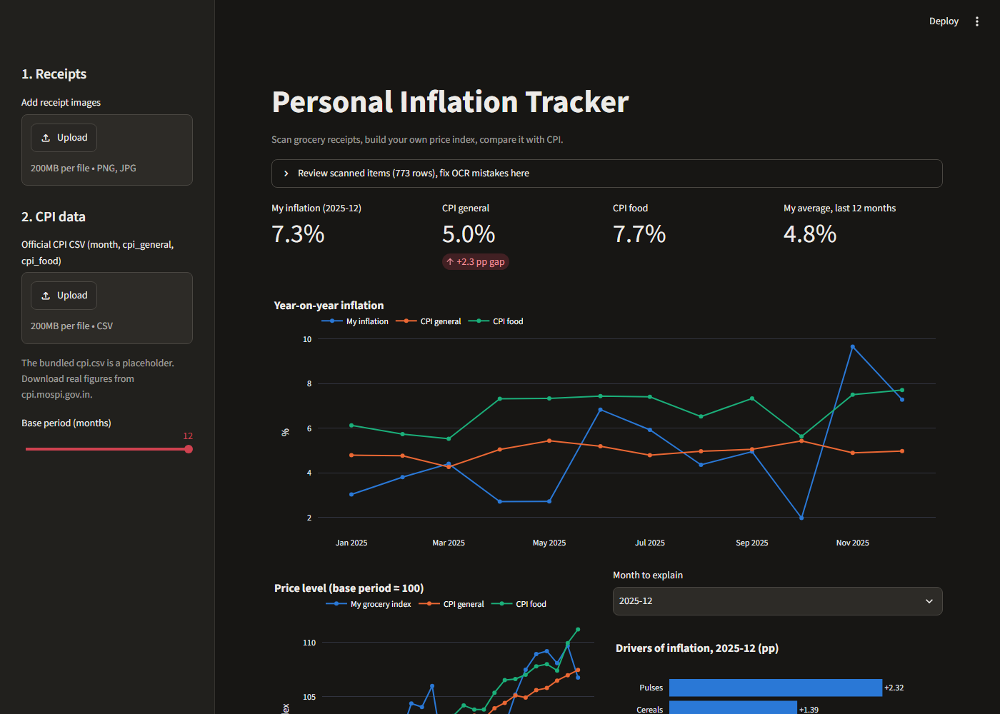

# Personal Inflation Tracker

[](https://personal-inflation-tracker-c9xkqmugsdtyvtycstakmv.streamlit.app/)

Scan grocery receipts with OCR, build a personal price index from what you actually buy, and compare your inflation rate with the official Consumer Price Index (CPI).

**Question:** Official CPI is an average over a national basket. Is *my* inflation the same?

**▶ Live demo:** https://personal-inflation-tracker-c9xkqmugsdtyvtycstakmv.streamlit.app/



**Highlights**
- OCR pipeline with validation rules: 97.8% of receipt lines recovered, with mistakes flagged rather than silently used
- Personal price index built with the same Laspeyres method used for official CPI, weighted by your own spending
- Tested against synthetic data with a known answer: the final inflation figure is within 0.3 percentage points of the truth
- Interactive dashboard: inflation vs CPI, the categories driving it, and item-level price changes

**Tech:** Python · pandas · RapidOCR · Plotly · Streamlit

> The demo uses synthetic receipts and a placeholder CPI series. See the *CPI data* section below.

## Pipeline

```
generate_receipts.py  ->  data/receipts/*.png         (dummy receipts, 24 months)
ocr_parser.py         ->  data/parsed_items.csv       (OCR + regex + fuzzy matching + validation)
inflation.py          ->  outputs/*.png, inflation_vs_cpi.csv  (Laspeyres index, YoY, contributions)
app.py                ->  Streamlit dashboard
```

## Set up on your computer

Needs Python 3.10 or newer. Run these from inside this folder:

```
python -m venv venv
venv\Scripts\activate          (on Mac/Linux: source venv/bin/activate)
pip install -r requirements.txt
python generate_receipts.py    # makes the dummy receipts (already included)
python ocr_parser.py           # scans them -> data/parsed_items.csv (~2 min)
python inflation.py            # prints results, saves charts to outputs/
streamlit run app.py           # opens the dashboard at http://localhost:8501
```

OCR uses **RapidOCR** (ONNX), which installs with pip, so you don't need Tesseract.

## Deploy (Streamlit Community Cloud, free)

1. Create a **public** GitHub repo, e.g. `personal-inflation-tracker`, and push this folder as the repo root:
   ```
   git init
   git add .
   git commit -m "Personal inflation tracker"
   git branch -M main
   git remote add origin https://github.com/<your-username>/personal-inflation-tracker.git
   git push -u origin main
   ```
2. Sign in at https://share.streamlit.io with GitHub, click **Create app**, choose the repo, branch `main`, main file `app.py`. Under *Advanced settings*, pick Python 3.12 or newer.
3. Click **Deploy**. The first build takes a few minutes. `requirements.txt` installs the Python packages, and `packages.txt` installs the Linux libraries OpenCV needs.

Notes:
- `data/parsed_items.csv` is committed, so the deployed app shows results straight away without running OCR on startup.
- The cloud server's disk is temporary. Receipts uploaded or corrections saved in the deployed app are lost when the app restarts. To keep a change, make it locally and push it.
- After any `git push`, the app redeploys automatically.

## Methodology

1. **Data generation.** Each of 17 items has its own yearly trend (e.g. toor dal +12%, sugar +3%), monthly noise, seasonal spikes (tomato in the monsoon, onion in Oct–Nov) and store-level markups. The receipts are rendered as images with tilt, blur and noise so the OCR has to deal with photo-like input.
2. **OCR and parsing.**
   - Text boxes are grouped into rows by their y-coordinate.
   - A regex extracts `ITEM  QTY  RATE  AMOUNT`.
   - `difflib` fuzzy-matches OCR'd names to the catalog.
   - **Validation:** each line must satisfy `qty × rate = amount`, and each receipt must match its TOTAL. If OCR drops the qty, it is recovered as amount ÷ rate. Lines that fail validation are flagged and left out of the index.
3. **Personal price index (Laspeyres, as in CPI).**
   - Monthly item price = median rate that month, which is robust to OCR misreads.
   - Base period = first 12 months. Weights = your spending share in the base period.
   - `I_t = 100 × Σ wᵢ · pᵢₜ / pᵢ₀`
   - YoY inflation `= I_t / I_{t-12} − 1`
   - Contributions by item/category add up exactly to headline inflation.
4. **Comparison with CPI.** Both series are rebased to base period = 100. You compare YoY rates, the gap in percentage points, and which categories drive the gap.

## Results on the dummy data (seed 42)

| Metric | Value |
|---|---|
| OCR: item lines recovered | 97.8% |
| OCR: unit price exactly right | 94.2% (98.8% on validated lines) |
| Error in YoY inflation, OCR vs ground truth | mean 0.26 pp, max 0.51 pp |
| My grocery inflation, Dec 2025 | 7.3% (CPI general 5.0%, CPI food 7.7%) |
| Biggest driver | Pulses (+2.3 pp): toor dal is 10.5% of the basket and up ~12% |

Because the receipts are synthetic, the "true" inflation is known, so you can measure how much error the OCR step adds to the final number. That makes a good point for your report.

## ⚠️ CPI data

`data/cpi.csv` is a **placeholder** generated so the project runs offline. It is not official data. Before you submit, replace it with real All-India CPI from MoSPI (https://cpi.mospi.gov.in), keeping the columns `month, cpi_general, cpi_food` (month as `YYYY-MM`). You can also upload the file in the dashboard sidebar.

## Ideas to extend (and discuss in your viva)

- **Substitution bias:** Laspeyres fixes the basket. Compare it with a Paasche or Fisher index.
- **Scanning real receipts:** add a preprocessing step (OpenCV deskew and thresholding) and measure the accuracy gain.
- **Forecasting:** fit ARIMA or Prophet to your index and forecast the next 3 months.
- **Anomaly detection:** flag prices that are more than 3 MAD from an item's median, as a second OCR check.
- **Store comparison:** a regression of price on item + store + month shows which shop is cheapest.

## Limitations

- Dummy data: the results show the method works, not what real-world inflation was.
- Groceries only, while CPI also covers housing, fuel, health, education and more. That's why your number is closer to **CPI food** than to **CPI general**.
- Parsing depends on one receipt layout. A different layout means changing `LINE_RE`.
